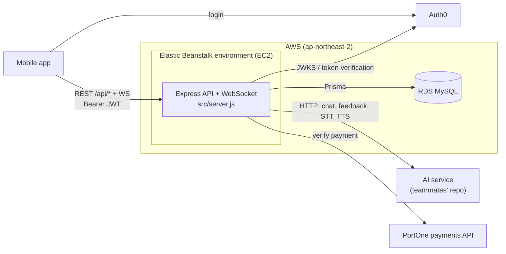

# LingoMate Backend

REST + WebSocket API for **LingoMate**, a mobile app for practising spoken English conversation with an AI partner.

> **Team project (7 members).** I owned the backend (this repository) and the AWS deployment.
> The mobile client and the AI service (chat, feedback, speech-to-text, text-to-speech) were built by teammates in separate repositories.

## Tech stack

| Area | Technology |
| --- | --- |
| Runtime / framework | Node.js 22, Express 5 (ES modules) |
| Database | MySQL via Prisma ORM (AWS RDS in deployment) |
| Auth | Auth0: RS256 JWTs checked with `express-oauth2-jwt-bearer` (REST) and `jsonwebtoken` + `jwks-rsa` (WebSocket) |
| Realtime | `ws` WebSocket server on the same HTTP port, JWT-authenticated handshake, heartbeat ping/pong |
| Audio | `multer` uploads, `ffmpeg` conversion to 16 kHz mono PCM before forwarding to the AI service |
| Payments | PortOne (iamport) server-side payment verification |
| API docs | Swagger UI at `/api-docs` (`swagger-jsdoc`), written spec in [`api-spec.md`](api-spec.md) |
| Infra | Docker, AWS Elastic Beanstalk (`.platform/hooks`), AWS RDS |

## Architecture



- **API server.** The API was first deployed on a single EC2 instance and later migrated to **Elastic Beanstalk**. The EB configuration lives in [`.platform/hooks/predeploy/01_install_ffmpeg.sh`](.platform/hooks/predeploy/01_install_ffmpeg.sh), a predeploy hook that installs a static `ffmpeg` build on each instance so the STT endpoint can transcode uploaded audio.
- **Database.** MySQL on **RDS**, accessed through **Prisma** ([`prisma/schema.prisma`](prisma/schema.prisma)). The models are `User`, `UserStat`, `Subscription`, `Payment`, `Conversation` and `Message`.
- **AI.** This server does not call an LLM directly. The `/api/ai/*` endpoints validate the request and proxy it to the team's AI service (`AI_SERVICE_URL`). Early versions of this backend called the Google Gemini API directly. That code was later removed in favour of the separate AI service.
- **Docker.** The [`Dockerfile`](Dockerfile) gave the team one shared, reproducible dev environment, independent of local Node setups.
- **Auth.** Every route except `/api/phrases` requires an Auth0 access token. On first call, `GET /api/auth/me` creates the user row, plus default stats and a free subscription, if it doesn't exist yet.

## API overview

**27 REST endpoints** are registered under `/api` in [`src/routes/apiRoutes.js`](src/routes/apiRoutes.js). The server also serves `GET /` (status text), `GET /api-docs` (Swagger UI) and the WebSocket upgrade (`?token=<JWT>`).

| Area | # | Endpoints |
| --- | --- | --- |
| Auth | 2 | `GET /auth/me`, `POST /auth/register-if-needed` |
| Users & settings | 4 | `GET`/`PUT /user/profile`, `GET`/`PUT /conversation/settings` |
| Conversations | 6 | `POST /conversation/start`, `POST /conversation/finish`, `POST /conversation/reset`, `GET /conversation/history`, `GET /conversation/:sessionId`, `DELETE /conversation/delete` |
| AI (proxied to AI service) | 9 | `POST /ai/stt`, `POST /ai/chat`, `POST /ai/feedback`, `POST /ai/tts`, `POST /ai/example-reply`, `POST /ai/review`, `GET /ai/stats/accuracy`, `GET /ai/conversation/history`, `POST /ai/conversation/reset` |
| Phrases | 1 | `GET /phrases` (static list, public) |
| Stats & home | 3 | `GET /stats`, `GET /dashboard`, `GET /home/status` |
| Notifications | 2 | `GET`/`PUT /notifications/settings` (placeholder responses, not persisted) |
| Subscriptions | 0 | See note below |

- `POST /conversation/finish` saves the transcript and messages, computes a session score, and updates time, sentence count and streak stats in a single Prisma transaction.
- **Subscriptions.** [`subscriptionController.js`](src/controllers/subscriptionController.js) implements plan options, PortOne payment verification (upgrade to premium plus a `Payment` record in one transaction) and cancel. Its routes (`/api/subscription/*`, documented in `api-spec.md`) are not registered in the current router, so they are not counted above.
- **Docs.** The full request/response spec, in Korean, is in [`api-spec.md`](api-spec.md). Swagger UI is mounted at `/api-docs`, but the route annotations it was generated from have since been removed, so the generated spec has no paths. `api-spec.md` is the reference.

All responses use one envelope ([`src/utils/response.js`](src/utils/response.js)):

```json
{ "success": true, "data": { }, "message": "ok", "meta": { "requestId": "..." } }
{ "success": false, "code": "BAD_REQ", "message": "...", "traceId": "..." }
```

## Local setup

You need a MySQL 8 database, an Auth0 tenant with an API (audience), and, for the AI endpoints, a running instance of the team's AI service.

```bash
cp .env.example .env    # then fill in the values; each variable is described in the file
```

### Option A: npm

Requires Node.js 22 and `ffmpeg` on your `PATH` (only needed for `POST /api/ai/stt`).

```bash
npm install             # also runs `prisma generate`
npx prisma db push      # create/update tables from prisma/schema.prisma
npm run dev             # loads .env and starts on $PORT (default 8080)
```

> Use `prisma db push` rather than `prisma migrate deploy`. The only migration in `prisma/migrations` predates the current schema.

### Option B: Docker

```bash
docker build -t lingomate-backend .
docker run --env-file .env -p 3000:3000 lingomate-backend
```

The container listens on port 3000. Run `npx prisma db push` against your database once (from the host, with `DATABASE_URL` set) before first use. The image does not include `ffmpeg`, so the STT endpoint only works on the host or on Elastic Beanstalk, where the predeploy hook installs it.

## Project structure

```
.platform/hooks/predeploy/   Elastic Beanstalk hook (installs ffmpeg)
prisma/                      Prisma schema + initial migration
src/
  server.js                  Express app, Swagger, WebSocket server
  routes/apiRoutes.js        All /api routes
  controllers/               auth, users, conversations, AI, stats, home, subscription
  lib/                       Prisma client, AI service STT/TTS clients
  utils/response.js          Response envelope helpers
api-spec.md                  API specification (v2.1, Korean)
```

## Status

The AWS resources (Elastic Beanstalk environment and RDS instance) were shut down after the project ended to stay within the AWS free tier, so **there is no live deployment**. The code is kept here as a reference.
